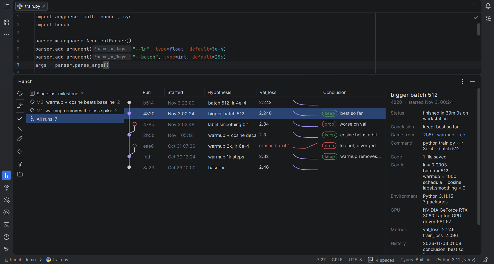

   
  

# Hunch for PyCharm

**Every hunch, tracked. Now in your IDE.**

Your [Hunch](https://github.com/sigmoid-ide/hunch) runs in a tool window: what each run tried, how it went,
and what it showed. Any two runs compare in the diff viewer.

  

- **The tree of runs**, with each run's hypothesis, main metric and its curve, and your conclusion. It updates while runs train.
- **Search and filter** all your runs: by hypothesis, conclusion, command, config or run id, or with filters
  such as `is:unreviewed`, `since:7d` or `val_loss<0.3`.
- **Run with Hunch**: one click next to the Run widget runs any Python configuration under Hunch, asking why first.
  **Run with Hunch on...**, in the Run widget's menu, runs it on one of your GPU machines with
  [Ferry](https://github.com/sigmoid-ide/ferry) (0.1.2 or newer, in the same interpreter) and brings the run home,
  or on a GPU you rent on Vast.ai with your own account (Ferry 0.2), given back once the run is home; you see the
  price and the most it can cost first.
- **Keep or drop** a run, write its conclusion, or fix its hypothesis, right from the table.
- **Compare** two runs, or a run with the one it came from (Ctrl+D): config, metrics and every changed code file.
- **Milestones**: save one from the toolbar when you find something worth remembering, then browse your runs milestone by milestone.

## Install

1. Install Hunch in your project's interpreter: `pip install sigmoid-hunch`
2. In PyCharm, open **Settings | Plugins | Marketplace**, search for **Hunch** and click **Install**, or get it from
   [JetBrains Marketplace](https://plugins.jetbrains.com/plugin/35831-hunch).

Every [release](https://github.com/sigmoid-ide/hunch-jetbrains/releases/latest) also has the plugin zip, for
**Settings | Plugins | ⚙ | Install Plugin from Disk...**.

## Search and filters

Type words to find runs by hypothesis, conclusion, command, config or run id. Add filters to narrow it down,
or pick common ones from the filter button in the tool window's toolbar:

| Filter | Finds |
|---|---|
| `is:unreviewed` | ended runs with no verdict or conclusion yet |
| `is:kept`, `is:dropped` | runs by verdict |
| `is:running`, `is:crashed`, `is:stopped`, `is:lost` | runs by how they ended, or that they have not |
| `is:remote`, `on:gpu-box` | runs on another machine (with [Ferry](https://github.com/sigmoid-ide/ferry)), or a named one |
| `since:7d`, `since:today`, `since:2026-11-01` | runs started since then |
| `from:a7f3` | that run and every run that came from it |
| `branch:main` | runs started on a git branch |
| `val_loss<0.3`, `lr=3e-4`, `optimizer=adam` | a final metric or config value (`<`, `<=`, `>`, `>=`, `=`) |

A run must match every word and filter. `-` turns one around (`-is:dropped`), and commas mean either
(`is:crashed,stopped`).

## Keyboard

Alt+Shift+H runs the selected Python configuration with Hunch, asking why first, wherever you are in PyCharm.

In the runs table:

| Key | Does |
|---|---|
| Up, Down; with Shift | move between runs; select several |
| Enter or Ctrl+D | compare the run with the one it came from, or the two selected runs |
| K, D | keep or drop the selected runs |
| C | write a conclusion |
| Shift+F6 (your Rename shortcut) | edit the hypothesis |
| Ctrl+F (your Find shortcut) | go to the search field; Down comes back to the table |
| Shift+F10 | everything else: open the run's folder, save a milestone, choose the metric column |

Apache-2.0 · Part of Sigmoid IDE · Like it? Give it a star.

